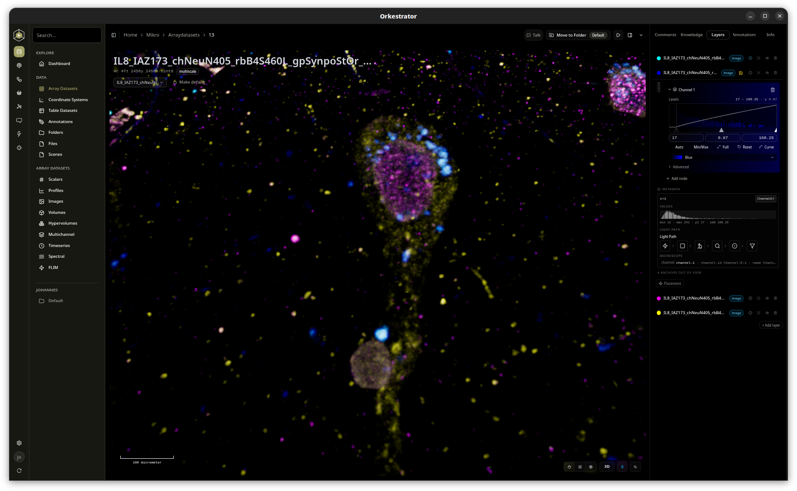

<p align="center">
  
</p>

<h1 align="center">Orkestrator</h1>

<p align="center">
  The desktop app for <a href="https://arkitekt.live">Arkitekt</a>: run your microscopes, analyses and workflows from one place.
</p>

<p align="center">
  <a href="https://github.com/arkitektio/orkestrator/releases/latest"></a>
  <a href="https://codecov.io/gh/arkitektio/orkestrator"></a>
  <a href="LICENSE"></a>
  <a href="https://arkitekt.live"></a>
</p>



[Arkitekt](https://arkitekt.live) is an open-source platform that connects the instruments, analysis tools and data
of a research lab. Orkestrator is its desktop client. Sign in to your lab's self-hosted Arkitekt server, and every
service it runs becomes a part of the app:

- **Look at your data.** Browse datasets, tables and files, and view multichannel 2D, 3D and time-lapse images in a GPU-accelerated viewer.
- **Run anything your lab has connected.** Microscopes, segmentation models and scripts register their actions with Arkitekt; Orkestrator turns each one into a form you can run, and follows the task as it runs.
- **Build workflows.** Wire actions into a workflow, save versions of it, and watch each run step by step.
- **Install apps.** Add apps from GitHub to your organization's app store and deploy them to your machines.
- **Keep track of what you know.** Record samples, measurements and how they relate in a knowledge graph.

Everything you can act on (an image, a task, a workflow) has the same right-click menu and shows up in the
<kbd>Ctrl</kbd>/<kbd>⌘</kbd>+<kbd>K</kbd> command palette, so an action an app offers is always one click away from
the data it works on.

**New to Arkitekt?** Start at [arkitekt.live](https://arkitekt.live) to set up a server, then come back for the app.

## Download

Get the latest version for your system from the [releases page](https://github.com/arkitektio/orkestrator/releases/latest).

| System | File | |
|---|---|---|
| Windows | `orkestrator-<version>-setup.exe` | Run the installer. If SmartScreen warns about an unknown publisher, choose **More info → Run anyway**. Uninstall from **Settings → Apps**. |
| macOS | `orkestrator-<version>.dmg` | Drag Orkestrator into Applications. Signed and notarized. |
| Linux | `orkestrator-<version>.AppImage` or `.deb` | The AppImage runs on most distributions (`chmod +x` it first); the `.deb` installs on Debian and Ubuntu. |

Orkestrator updates itself. To try features before they are released, switch the update channel to **Next** under
**Settings → Developer**.

## What's inside

Each Arkitekt service has a module in the app, and a module only appears when your server runs that service. The main ones:

| Module | What it does |
|---|---|
| **Mikro** | Image data: datasets, tables, meshes, annotations and files, with the image viewer |
| **Rekuest** | The apps connected to your server, the actions they offer, and the tasks you run |
| **Fluss** | Workflows built from actions, their versions and their runs |
| **Kabinet** | Your organization's app store, built from GitHub repositories |
| **Kraph** | Knowledge graphs of your samples, measurements and how they relate |
| **Elektro** | Electrophysiology: recorded and simulated traces, neuron models and experiment timelines |
| **Alpaka** | Chats with language models about your data |
| **Lovekit** | Live camera and microphone streams that apps offer |
| **Omero Ark** | The projects, datasets and images of an OMERO server |
| **Dokuments** | PDFs and scans, split into pages with their recognized text |
| **Team** (Lok) | Your organization, its members and their roles |

## Develop

You need [Node.js 22](https://nodejs.org) and [pnpm](https://pnpm.io) (`corepack enable` picks the pinned version).
[Go](https://go.dev) is optional: it builds the mesh sidecar in `tools/meshd`; without it, the app runs with the mesh
turned off.

```bash
pnpm install
pnpm dev          # start the app with hot reload
```

| Command | |
|---|---|
| `pnpm test` | Unit tests (Vitest) |
| `pnpm typecheck` | TypeScript check of the renderer |
| `pnpm build:win` / `build:mac` / `build:linux` | Package installers into `dist/` |
| `pnpm <service>` (e.g. `pnpm mikro`) | Regenerate a service's GraphQL client from its `<service>.yml` |

The code is split into `src/main` (Electron's main process), `src/preload` and `src/renderer`. In the renderer,
`app/` composes the app, `core/` holds what the modules share, and each Arkitekt service has its own folder.
[CLAUDE.md](CLAUDE.md) describes the conventions: module boundaries, service guards, dialogs, local actions and the
context menu.

### Releases

Releases are cut by [semantic-release](https://semantic-release.gitbook.io) from
[Conventional Commits](https://www.conventionalcommits.org) (`feat(mikro): …`, `fix: …`). A push to `main` publishes a
stable release; a push to `next` publishes a prerelease for the Next channel. GitHub Actions then builds and uploads
the installers for every platform.

## Contributing

Bug reports and pull requests are welcome. Inside the app, **Report a bug** opens a prefilled GitHub issue with the
details we need. For questions about Arkitekt itself, see [arkitekt.live](https://arkitekt.live).

## License

[MIT](LICENSE)
